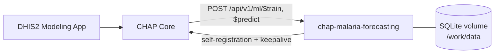

# CHAP Malaria Forecasting

A [chapkit](https://github.com/dhis2-chap/chapkit) model service for
[CHAP](https://github.com/dhis2-chap/chap-core) that forecasts weekly malaria
cases up to 12 weeks ahead (as many weeks as CHAP asks for). It exposes three
models in the DHIS2 Modeling App, all served by one container:

| Shown in the Modeling App                                    | Configured model                        | What it does                                                 |
| ------------------------------------------------------------ | --------------------------------------- | ------------------------------------------------------------ |
| Malaria Weekly Forecast (Gradient Boosting) [Xgboost]        | `chap-malaria-forecasting:xgboost`      | XGBoost, `count:poisson`, one estimator per horizon          |
| Malaria Weekly Forecast (Gradient Boosting) [Lightgbm]       | `chap-malaria-forecasting:lightgbm`     | LightGBM, `poisson`, one estimator per horizon               |
| Malaria Weekly Forecast (Gradient Boosting) [Best of both]   | `chap-malaria-forecasting:best_of_both` | Trains both, keeps the one with the lower out-of-sample MAE  |

CHAP builds the displayed name as `<template> [<configuration>]` and lowercases
all but the first letter of the configuration, hence "Xgboost".

It was built for health-zone level surveillance in the DRC (514 zones), but
nothing in it is country-specific: any CHAP deployment with weekly case data,
rainfall, temperature and population can use it.

> **Status: `0.2.0`, assessed status orange.** The software is tested end to end
> on synthetic data only. It has not been validated scientifically on real
> surveillance data. Run a CHAP backtest on your own data, and have it reviewed
> by an epidemiologist, before using the forecasts for decisions.

## Contents

- [CHAP Malaria Forecasting](#chap-malaria-forecasting)
  - [Contents](#contents)
  - [How it works](#how-it-works)
  - [Compatibility](#compatibility)
  - [Data contract](#data-contract)
  - [Model options](#model-options)
  - [Run it locally](#run-it-locally)
  - [Deploy in CHAP](#deploy-in-chap)
    - [A. With `chap-admin` (recommended)](#a-with-chap-admin-recommended)
    - [B. With the Compose overlay](#b-with-the-compose-overlay)
    - [Verify](#verify)
  - [Operate it](#operate-it)
  - [Develop and release](#develop-and-release)
  - [Limitations](#limitations)
  - [License](#license)

## How it works



- **Direct multi-horizon.** One model per horizon (t+1, t+2, t+3). Predicted
  values are never fed back as if they were observations.
- **Causal features, per zone.** Case lags (1, 2, 3, 4, 8, 52 weeks), rolling
  means and standard deviations shifted by one week, incidence per population,
  rainfall and temperature lagged 1 to 12 weeks, seasonal sin/cos, zone
  identifier and missing-value indicators. No window ever includes the week
  being predicted.
- **Selection without look-ahead.** The `auto` model ranks engines on a
  rolling-origin backtest of the training history only, with a minimum number
  of observations and a hysteresis margin to avoid flip-flopping. With too
  little history it keeps the configured champion and says so.
- **Traceable fallback.** If the selected engine cannot load or predict, the
  service falls back to the other engine, then to a seasonal naive model, and
  records the fallback. If nothing can predict, the job fails; it never invents
  values.
- **Honest uncertainty.** `sample_0..sample_N` are drawn from out-of-sample
  residuals per horizon, collected during the selection backtest. When there
  are not enough residuals, the service returns the point forecast as
  `sample_0` only rather than duplicating it. The samples are not claimed to be
  calibrated.
- **Self-contained artifacts.** A training result embeds the native XGBoost
  JSON / LightGBM text models with SHA-256 checksums, inside chapkit's own
  artifact store. The SQLite database on the data volume is the only state.

## Compatibility

| Component      | Version                                                       |
| -------------- | ------------------------------------------------------------- |
| CHAP Core      | 2.4.0 (contract checked against the tagged source, see below) |
| chapkit        | 2.4.1 in the service (`>=2.4.1,<3`), servicekit 3.0.1         |
| Python         | 3.13                                                          |
| Image platform | `linux/amd64` (published by CI); arm64 works for local runs   |
| Period type    | weekly; horizon 1 to 12 periods                               |

CHAP Core 2.4.0 itself depends on `chapkit>=2.1.0,<3` and reads prediction
artifacts with chapkit 2.1.0. The wire format written by chapkit 2.4.1 is
accepted by 2.1.0 (same artifact keys, `schema` alias on DataFrames). The
integration tests drive the service exactly as Core 2.4.0's
`chapkit_rest_api_wrapper.py` does. Details, with links to the source lines, are
in [docs/compatibility-matrix.md](docs/compatibility-matrix.md). No test has been
run against a live CHAP instance yet.

## Data contract

CHAP sends these columns; the service validates them before training and
prediction, and rejects the request with a clear message otherwise.

| Column             | Required | Rule                                                         |
| ------------------ | -------- | ------------------------------------------------------------ |
| `time_period`      | yes      | ISO week, e.g. `2025-W07`; weeks contiguous per location     |
| `location`         | yes      | stable identifier; unique with `time_period`                 |
| `disease_cases`    | yes      | non-negative; missing stays missing (never replaced by zero) |
| `rainfall`         | yes      | non-negative                                                 |
| `mean_temperature` | yes      | finite                                                       |
| `population`       | yes      | strictly positive                                            |
| `parent`           | no       | used as a regional feature when present                      |

- **History length.** Lag-52 features need about 55 weeks per location. The
  `auto` backtest needs `selection_min_train_weeks` (default 104) plus three
  weeks per split; with less, `auto` keeps the champion and the forecast has a
  single sample.
- **Future rows.** The `future` frame must only contain locations seen in the
  history. Its climate values are accepted but not used: the model relies on
  lagged climate only, so it does not depend on climate forecasts.
- **Output.** One row per requested `(location, time_period)`, the future
  columns unchanged, plus `sample_0..sample_N`, all finite and non-negative.

## Model options

Every field of `MalariaModelConfig`
([service.py](src/chap_malaria_forecasting/chapkit_adapter/service.py)) is a
user option of the CHAP model template, so you can create more configurations
in the Modeling App.

| Option                          | Default    | Meaning                                                             |
| ------------------------------- | ---------- | ------------------------------------------------------------------- |
| `engine`                        | `auto`     | `xgboost`, `lightgbm` or `auto`                                     |
| `auto_mode`                     | `select`   | `select`, `ensemble` (inverse-MAE weights) or `champion_challenger` |
| `champion`                      | `xgboost`  | engine kept when evidence is insufficient or the margin is not met  |
| `switch_margin`                 | `0.02`     | relative MAE improvement needed to move away from the champion      |
| `n_estimators`                  | `120`      | trees per horizon (10 to 1000)                                      |
| `n_threads`                     | `1`        | threads per engine (1 to 12)                                        |
| `random_seed`                   | `20261025` | seed for engines and sampling                                       |
| `selection_backtest_splits`     | `3`        | rolling-origin splits used by `auto` and for residuals (2 to 7)     |
| `selection_min_train_weeks`     | `104`      | minimum training weeks before the first backtest split              |
| `selection_min_observations`    | `100`      | minimum scored forecasts before an engine can be ranked             |
| `prediction_samples`            | `100`      | number of `sample_N` columns when residuals are available           |
| `minimum_residuals_per_horizon` | `20`       | residuals per horizon needed before samples are produced            |
| `seasonal_fallback`             | `true`     | allow the seasonal naive model as last-resort fallback              |

`prediction_periods` is set by CHAP for each run (1 to 12) and the service
trains exactly that many horizons: a backtest usually asks for 3, while a
weekly prediction without an explicit horizon asks for 12 (CHAP's default).
Training 12 horizons takes about four times longer than 3, and forecasts
further ahead are less accurate; check the backtest for the horizon you use.
A model trained for N weeks refuses a request for more than N.

## Run it locally

You need [uv](https://docs.astral.sh/uv/). CHAP, DHIS2 and Docker are not
needed for this.

```bash
uv sync --frozen
uv run pytest -q                                   # unit, contract, integration tests
uv run uvicorn main:app --host 127.0.0.1 --port 9090
```

Then open `http://127.0.0.1:9090/docs`, or check `GET /health` and
`GET /api/v1/info`. Registration is disabled unless
`SERVICEKIT_ORCHESTRATOR_URL` is set.

To try the published image on its own:

```bash
docker run --rm -p 127.0.0.1:9090:8000 ghcr.io/ebed-meleck/chap-malaria-forecasting:sha-<commit>
```

Benchmark the full CHAP train and predict path on synthetic data:

```bash
uv run chap-malaria-benchmark --zones 514 --engine auto --through-service \
  --n-estimators 120 --threads 4
```

## Deploy in CHAP

There are two supported ways, both documented by CHAP. **Use one, not both**:
they would register the same service id twice, and CHAP sends work to
whichever registered last.

|                   | A. `chap-admin` + marketplace entry                  | B. Hand-written Compose overlay                       |
| ----------------- | ---------------------------------------------------- | ----------------------------------------------------- |
| Compose service   | written for you in `compose.marketplace.yml`         | `compose.chap-malaria-forecasting.yml` from this repo |
| Configured models | the three are created automatically                  | you create them with three API calls                  |
| Image check       | refuses an image whose commit does not match the pin | none                                                  |
| Failed update     | rolled back automatically                            | manual                                                |
| Resource limits   | add them to the generated service                    | included                                              |

Both need an image published by CI (`ghcr.io/ebed-meleck/chap-malaria-forecasting:sha-<7 chars>`).
If the package is private, run `docker login ghcr.io` on the CHAP host first,
with a token limited to `read:packages`.

### A. With `chap-admin` (recommended)

`chap-admin` ships with the `chap-core` package. It reads a model marketplace
registry; this repository carries its own in [marketplace/](marketplace/). An
entry is installable only once a release is pinned in it (see
[Develop and release](#develop-and-release)).

On the CHAP host, in the deployment directory:

```bash
# 1. chap-admin, same version as the running CHAP Core
uv tool install chap-core==2.4.0 --python 3.13

# 2. Serve the marketplace directory of this repository on localhost
git clone https://github.com/Ebed-meleck/chap-malaria-forecasting.git ~/chap-malaria-forecasting
python3 -m http.server 8765 --bind 127.0.0.1 \
  --directory ~/chap-malaria-forecasting/marketplace &
MARKETPLACE_PID=$!
export CHAP_MARKETPLACE_URL=http://127.0.0.1:8765

# 3. Only if CHAP sets CHAP_API_TOKEN (see "Authentication" below):
#    chap-admin does not read .env, and the service needs a key to register
# export CHAP_API_TOKEN="$(grep '^CHAP_API_TOKEN=' .env | cut -d= -f2-)"
# sed -i '/^SERVICEKIT_REGISTRATION_KEY=$/d' .env   # drop an empty definition first
# grep -q '^SERVICEKIT_REGISTRATION_KEY=' .env || echo 'SERVICEKIT_REGISTRATION_KEY=${CHAP_API_TOKEN}' >> .env

# 4. Install. --compose-file lists the base files you deploy CHAP with, in
#    order (default: compose.yml). --accept-risk is required for any registry
#    other than the official CHAP marketplace.
chap-admin install chap_malaria_forecasting --compose-file compose.ghcr.yml --accept-risk

kill "${MARKETPLACE_PID}"
```

If the repository is public you can skip the local server and use
`CHAP_MARKETPLACE_URL=https://raw.githubusercontent.com/Ebed-meleck/chap-malaria-forecasting/main/marketplace`.

`chap-admin` pulls the pinned image, starts the service
`marketplace-chap-malaria-forecasting` with a data volume, waits until it
registers with the expected service id and commit, creates the three configured
models, and only then writes `compose.marketplace.yml`. From then on, include
that file in every Compose command for this deployment, for example
`docker compose -f compose.ghcr.yml -f compose.marketplace.yml up -d`.

To cap resources, add to the generated service in `compose.marketplace.yml`
(kept by later `chap-admin update` runs), then recreate it with
`docker compose ... up -d --no-deps marketplace-chap-malaria-forecasting`:

```yaml
cpus: "4.0"
mem_limit: 16g
environment:
  OMP_NUM_THREADS: "4"
```

Updating is the same command with `update`, after a new release is pinned. If
the new container does not come up and register, `chap-admin` restores the
previous one. To roll back a release that works but forecasts badly, set
`channels.stable` back to the previous version in the entry and run `update`
again; earlier template versions and their backtests stay in CHAP.

### Authentication

When CHAP sets `CHAP_API_TOKEN`, every route is protected, including the
registration endpoint `POST /v2/services/$register`. A chapkit service can only
send `X-Service-Key: $SERVICEKIT_REGISTRATION_KEY`, which CHAP 2.4.0 accepts
when it equals either `CHAP_API_TOKEN` or a `SERVICEKIT_REGISTRATION_KEY` set
**in the `chap` container** (`compose.ghcr.yml` does not pass one). Without it,
registration gets 401 five times, the service never appears in `/v2/services`,
and `chap-admin install` rolls back. Two ways to fix it:

- **Quick, no CHAP restart:** add `SERVICEKIT_REGISTRATION_KEY=${CHAP_API_TOKEN}`
  to `.env`. The model container then holds the full API token.
- **Narrower:** generate a dedicated key (`openssl rand -hex 32`), put it in
  `.env` as `SERVICEKIT_REGISTRATION_KEY`, pass it to the `chap` service in an
  overlay (`environment: {SERVICEKIT_REGISTRATION_KEY: ${SERVICEKIT_REGISTRATION_KEY}}`)
  and recreate `chap`. CHAP accepts that key on `/v2/services` only.

Check which case you are in without registering anything (the empty body is
rejected by validation, so nothing is stored):

```bash
curl -s -o /dev/null -w '%{http_code}\n' -X POST 'http://localhost:8000/v2/services/$register' \
  -H 'Content-Type: application/json' -d '{}'                        # 401: a key is required
curl -s -o /dev/null -w '%{http_code}\n' -X POST 'http://localhost:8000/v2/services/$register' \
  -H 'Content-Type: application/json' -H "X-Service-Key: $KEY" -d '{}' # 422: the key is accepted
```

### B. With the Compose overlay

[compose.chap-malaria-forecasting.yml](compose.chap-malaria-forecasting.yml)
follows chapkit's "Deploying to chap-core" guide and adds hardening and limits:
non-root user, read-only root filesystem, no capabilities, CPU/memory/PID
limits, rotated logs, no published port, and the project's default network
only (CHAP 2.4.0 keeps Postgres and Valkey on a separate `backend` network).

```bash
# In the CHAP deployment directory
cp ~/chap-malaria-forecasting/compose.chap-malaria-forecasting.yml .
cat ~/chap-malaria-forecasting/deploy/runtime.env.example >> .env
${EDITOR:-vi} .env                      # set MALARIA_FORECASTING_IMAGE

FILES="-f compose.ghcr.yml -f compose.chap-malaria-forecasting.yml"
docker compose $FILES config --quiet
docker compose $FILES up -d --no-deps chap-malaria-forecasting
```

Registration creates the model template but no configured model. Create the
three, using the template id CHAP assigned (never hard-code it):

```bash
CHAP=http://localhost:8000
AUTH=()                                  # AUTH=(-H "Authorization: Bearer $CHAP_API_TOKEN")
TEMPLATE_ID=$(curl -fsS "${AUTH[@]}" "$CHAP/v1/crud/model-templates" \
  | jq '[.[] | select(.name == "chap-malaria-forecasting")] | max_by(.id) | .id')

for ENGINE in xgboost lightgbm auto; do
  curl -fsS "${AUTH[@]}" -X POST "$CHAP/v1/crud/configured-models" \
    -H 'Content-Type: application/json' \
    -d "{\"name\": \"$ENGINE\", \"modelTemplateId\": $TEMPLATE_ID, \"userOptionValues\": {\"engine\": \"$ENGINE\"}}"
done
```

An identical configuration is not stored twice, so the loop can be re-run. To
update, change `MALARIA_FORECASTING_IMAGE` and run the same `up` command; to
roll back, put the previous image back. Never use `docker compose down -v`.

### Verify

```bash
curl -fsS "$CHAP/v2/services" | jq '.services[] | {id, url}'
curl -fsS "$CHAP/v1/crud/model-templates" \
  | jq '.[] | select(.name == "chap-malaria-forecasting") | {id, version, healthStatus}'
curl -fsS "$CHAP/v1/crud/configured-models" | jq '.[] | .name' | grep chap-malaria-forecasting
```

Expected: the service listed, the template with `healthStatus` `live`, and the
three configured models. They then appear in the DHIS2 Modeling App model list;
run a small backtest with each before a full one.

If the template shows `revision_mismatch`, an image built from another commit
was registered under the same version: bump the version and release again.
The service must keep pinging CHAP every few seconds; if it disappears from
`/v2/services`, check its logs for `keepalive` errors.

## Operate it

- **State and backups.** Everything (configs, training artifacts, predictions)
  is in `/work/data/chapkit.db` on the service's volume. Back it up with the
  service stopped; restore into a new volume and keep the old one until the
  restored service has been verified. Training artifacts are tied to the
  service's descriptor format: a release that changes it asks CHAP to retrain.
- **Resources.** CHAPKit runs one job at a time per service. Memory and time
  grow with zones x weeks x trees; `auto` trains each engine 3 + 3 x splits
  times. Measured on a macOS arm64 laptop with synthetic data, 514 zones x 196
  weeks, 120 trees, 4 threads, through the service callbacks:

  | Configuration | Train | Predict | Peak RSS | Stored artifact |
  | ------------- | ----- | ------- | -------- | --------------- |
  | `xgboost`     | 40 s  | 3.9 s   | 525 MiB  | 1.5 MiB         |
  | `lightgbm`    | 43 s  | 4.0 s   | 477 MiB  | 1.3 MiB         |
  | `auto`        | 82 s  | 4.1 s   | 519 MiB  | 2.7 MiB         |

  A CHAP backtest repeats train and predict once per split. Re-measure on your
  server with `chap-malaria-benchmark --through-service` and set limits from
  the result.

- **Logs.** Structured events include `malaria_models_trained` (engines,
  selection, uncertainty) and `malaria_predictions_created` (selected model,
  fallback and reason). `/metrics` exposes Prometheus metrics on the internal
  network.
- **Security.** The service API has no authentication of its own: never publish
  its port. The training artifact is pickled by chapkit; only artifacts the
  service wrote itself are ever loaded, and the embedded models are checked
  against their SHA-256 before use.

The DRC production runbook (pre-checks, gradual acceptance at 10, 100 and 514
zones, backup and rollback commands) is in
[docs/PRODUCTION_DEPLOYMENT.md](docs/PRODUCTION_DEPLOYMENT.md) and
[docs/OPERATIONS.md](docs/OPERATIONS.md) (in French).

## Develop and release

```text
src/chap_malaria_forecasting/
  data/              validation, ISO weeks
  features/          causal per-zone features
  models/            xgboost/, lightgbm/, naive.py, ensemble/ (selection, fallback)
  forecasting/       direct multi-horizon forecaster, residual sampler
  evaluation/        rolling-origin backtest, metrics, benchmark CLI
  artifacts/         checksummed native model bundles
  synthetic/         reproducible synthetic data for tests
  chapkit_adapter/   the only module that imports chapkit
main.py              ASGI entry point (uvicorn main:app)
marketplace/         marketplace registry and entry read by chap-admin
deploy/              container start script, healthcheck, env example, pin_release.py
tests/               unit/, contracts/, integration/, performance/
```

Quality gates, also run by CI:

```bash
uv run ruff format --check . && uv run ruff check .
uv run mypy src
uv run pytest -q
```

Release flow:

1. Bump `version` in `pyproject.toml` and `MODEL_VERSION` in
   `chapkit_adapter/service.py` (a test keeps them equal). CHAP refuses a new
   commit under an already registered version.
2. Merge to `main`. CI runs the gates and a dependency audit, builds the
   `linux/amd64` image, smoke-tests it without network, and publishes
   `sha-<7 chars>` and `sha-<40 chars>` tags with SBOM and provenance.
3. Run the acceptance checks on a staging CHAP.
4. Pin the release for `chap-admin`, then commit:

   ```bash
   uv run python deploy/pin_release.py --commit <40-char commit sha>
   ```

   A fork published under another GitHub owner must update `source` in
   `marketplace/models/chap_malaria_forecasting.yaml` (the image path must be
   lowercase) and `REPOSITORY_URL` in `chapkit_adapter/service.py`; a test
   keeps the two consistent.

Once the model has been validated on real data, the same entry can be proposed
to the official [CHAP model marketplace](https://github.com/dhis2-chap/model-marketplace),
after which `chap-admin install chap_malaria_forecasting` works without
`--accept-risk` or a custom registry.

## Limitations

- Validated on synthetic data only; forecast skill on real data is unknown.
- Samples come from empirical residuals and are not calibrated; check coverage
  and CRPS in CHAP's backtest before relying on intervals.
- Weeks must be contiguous per location in the history sent by CHAP.
- Locations not present in the training history cannot be forecast.
- Not yet run against a live CHAP 2.4.0 instance or the Modeling App; the
  container image is built and smoke-tested in CI only.

See [docs/IMPLEMENTATION_REPORT.md](docs/IMPLEMENTATION_REPORT.md) for the full
verification record and [WORKLOG.md](WORKLOG.md) for the commands actually run.

## License

Copyright (C) 2026 HISP DRC.

This program is free software: you can redistribute it and/or modify it under
the terms of the GNU Affero General Public License as published by the Free
Software Foundation, either version 3 of the License, or (at your option) any
later version. It is distributed WITHOUT ANY WARRANTY; see [LICENSE](LICENSE).

The same license as [chapkit](https://github.com/dhis2-chap/chapkit) and
[chap-core](https://github.com/dhis2-chap/chap-core), which the service builds
on. Under section 13, if you run a modified version for users who interact with
it over a network (for example through CHAP and the DHIS2 Modeling App), you
must offer them its source code. `/api/v1/info` reports the source repository
(`model_metadata.repository_url`) and the exact commit (`git_revision`); keep
both pointing at your modified source.
